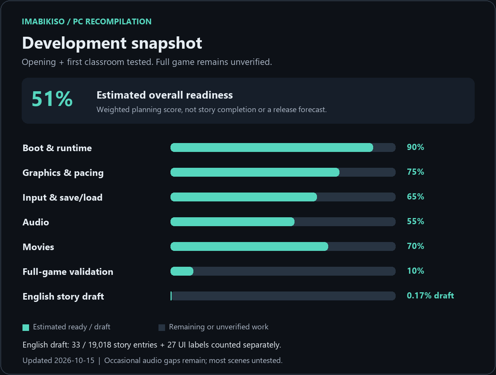

<div align="center">

# Imabikisō · PC Recompilation

**Bringing 忌火起草 to PC, with an experimental machine-translated English edition.**

An independent, community-led project built with [ps3recomp](https://github.com/sp00nznet/ps3recomp).

**Windows prototype · Early scenes running · English preview · Work in progress**

[Screenshots](#screenshots) · [Progress](#progress) · [What works](#what-works-today) · [Build & source](#code-and-building) · [English translation](#english-machine-translation) · [Roadmap](docs/roadmap.md) · [Contributing](CONTRIBUTING.md)

</div>

---

Imabikisō is a Japanese horror visual novel from Chunsoft. This project explores running the PS3 release **BLJM60042 / 01.00** as a native PC program through static recompilation, alongside tools for extracting, understanding and patching its scripts.

**The port uses the original game's code recompiled through ps3recomp.** The earlier custom C++ engine experiment was abandoned and is no longer part of the current source tree. The goal is to preserve the original engine and behavior; complete fidelity has not yet been achieved or verified. The remaining C++ archive/script tools support extraction and translation rather than replacing the game engine.

The current prototype boots, renders the opening and reaches the first classroom narration. A separate English preview replaces some menus and opening text. **This is an experimental developer build, not a finished port or a verified full playthrough.**

No game executable, generated game code, disc image, fonts, sound or video is included. You need your own game dump and locally generated files to build and run the native port.

## Screenshots

Actual captures from the native PC prototype, showing the **English machine-translation draft**. The title logo remains Japanese. Captured on 14 October 2026; click an image for the full 1280 × 720 PNG.

| English title menu | Opening prologue |
|:---:|:---:|
| [](docs/screenshots/01-english-menu.png) | [](docs/screenshots/02-prologue-why-me.png) |
| **New Game / Continue** | **“Why me……?”** |

| Prologue narration | First classroom text |
|:---:|:---:|
| [](docs/screenshots/03-prologue-hallucination.png) | [](docs/screenshots/04-classroom-english.png) |
| **“A hallucination. It has to be.”** | **First classroom narration rendered in English** |

[Full-resolution gallery and captions](docs/screenshots/README.md). These stills show rendering and text only; audio interruptions and movie stutters remain.

## Progress



**Updated: 14 October 2026.** The chart is a planning estimate based on the milestones below. It is **not** an automated compatibility score, a percentage of the story that is playable, or a release-date prediction. Full-game compatibility remains largely untested.

| Workstream | Estimate | Current evidence | Still to do |
|---|---:|---|---|
| Boot & runtime | 90% | Startup, system callbacks, fonts and initial loading run | Regression tests and less common system paths |
| Graphics & pacing | 65% | Opening and classroom render; about 57–60 presentations/s in sampled scenes | Wider effects coverage, unique-frame pacing, scene regressions |
| Input & save/load | 65% | Keyboard/controller confirmation and early save/load exercised | Longer sessions, all menus and save-slot edge cases |
| Audio | 35% | Audio plays; device output keeps its nominal rate | Crackling, upstream PCM interruptions and synchronization |
| Movies | 35% | Opening movies decode and display | Remaining stutters, decode deadlines and A/V timing |
| Full-game validation | 10% | Opening and first classroom tested | Branches, routes, endings, long-session stability |
| English story coverage | 0.17% draft | 33 of 19,018 exported script entries; 27 UI labels separately | Machine translation, layout checks, context and terminology review |

Overall **41%** is a weighted planning score, rounded to a whole number. It deliberately gives substantial weight to audio, movies and full-game testing. [Weights and definitions](docs/roadmap.md#how-the-percentages-work) · [Source data](docs/progress.json).

## What works today

- PS3 startup proceeds through the early initialization barriers and system callbacks.
- The live renderer displays the opening, backgrounds and first story text.
- Font handling, text encoding and callback thread-local state have been corrected for the tested paths.
- Input responds after a pad capability structure fix. Japanese confirmation uses **Circle**.
- Early save data is written and loaded with the correct filename.
- A separate English preview displays the title-menu labels, prologue and first classroom lines.
- The script tools can read archives, export stable text IDs and rebuild a translated script archive with structural checks.

## Known problems

**Audio crackling and movie stutters are still present.** A near-60 presentation rate does not mean every movie frame is decoded on time. Interruptions also appear in the recorded PCM before device output, so a larger speaker buffer alone does not resolve them.

The rest of the game has not been validated. Later effects, menus, choices, routes and long sessions may expose rendering errors, freezes or crashes. Some UI text is stored in images and remains Japanese. There is no release date yet.

See the [roadmap](docs/roadmap.md) for the next milestones and what must pass before a playable release.

## English machine translation

The planned English edition will use **machine translation assisted by AI**. It will be labeled as such; it is not an official localization or a professional human translation.

The current preview contains **33 draft script entries and 27 menu/dialog labels**. That is a small technical and layout test, not a translated game. Story coverage is calculated from the 19,018 exported main-script entries; menu labels are counted separately because the full UI inventory is not complete.

The intended workflow is to translate by stable script ID, preserve control instructions, use a consistent glossary, and check the result in-game for overflow, missing glyphs and broken choices. Human corrections are welcome. The English files load from a separate local preview directory with separate saves/settings.

[English preview text](translations/en/preview.json) · [Translation workflow](translations/README.md) · [Patching documentation](docs/patching.md)

## Code and building

| Directory | Contents |
|---|---|
| [`src/`](src/) | Supporting C++ archive, script and translation tools |
| [`native/`](native/) | Native port runner, ABI bridges and CMake integration |
| [`patches/ps3recomp/`](patches/ps3recomp/) | Local runtime/lifter fixes against a pinned upstream commit |
| [`translations/`](translations/) | English draft text and workflow |
| [`docs/`](docs/) | Format research, progress data and technical notes |
| [`tools/`](tools/) | Progress-chart generation and diagnostics |

### Build the asset and translation tools

Requirements: CMake 3.20+, a C++20 compiler and Ninja (or another CMake generator). Non-Windows builds also need Iconv.

```sh
cmake -S . -B build -G Ninja -DCMAKE_BUILD_TYPE=Release
cmake --build build
ctest --test-dir build --output-on-failure
```

```sh
imbk verify "Imabikisou (Japan).iso"
imbk sns text "Imabikisou (Japan).iso" out/lines.tsv
imbk unpack "Imabikisou (Japan).iso" out/disc
imbk patch "Imabikisou (Japan).iso" out/translation.tsv out/disc
```

These commands build the supporting tools, **not the native game executable**. The native game uses the ps3recomp integration below; there is no custom replacement-engine target.

### Build the native port

The tested configuration is **Windows x64, Direct3D 12, clang-cl and an AVX2-capable CPU**. Other configurations are not validated by this project.

The public sources require your locally decrypted ELF and locally lifted PPU/SPU sources; those are intentionally excluded. The SDK changes are pinned to `a2c20108af45174dbb7d3e2f87f6acaaef09c6b4`. This is a developer workflow, not a one-click installer.

Follow [native/README.md](native/README.md) for patch application, private inputs, configuration and controls.

## Next milestones

- [ ] Eliminate the reproducible audio interruptions in the opening jingle.
- [ ] Keep movie decoding and sound synchronized through demanding sections.
- [ ] Validate longer play sessions, choices and save/load regressions.
- [ ] Extend the English machine-translation pipeline with glossary and layout checks.
- [ ] Record a representative progress video with the current limitations clearly identified.

## People, tools and acknowledgements

This is a human-directed project developed with assistance from **ChatGPT / Codex (OpenAI)** and **Claude Opus (Anthropic)** for code, reverse-engineering analysis, debugging and translation experiments. AI assistance does not imply endorsement by either company, and generated suggestions still need testing and review.

Special thanks to **sp00nznet and the ps3recomp contributors** for the recompilation framework, and to the original creators of Imabikisō. Additional testing, technical contributions and corrections are welcome.

## License and game files

Project code is MIT-licensed; see [LICENSE](LICENSE) and [third-party notices](THIRD_PARTY_NOTICES.md). Imabikisō and its content belong to their respective rights holders. This is an unofficial project with no affiliation or endorsement.

The gameplay screenshots document the prototype. The underlying game artwork and logo remain the property of their respective rights holders and are not covered by the project's MIT code license.

Please do not upload game files, extracted assets, complete script dumps or generated game sources to issues or pull requests.
