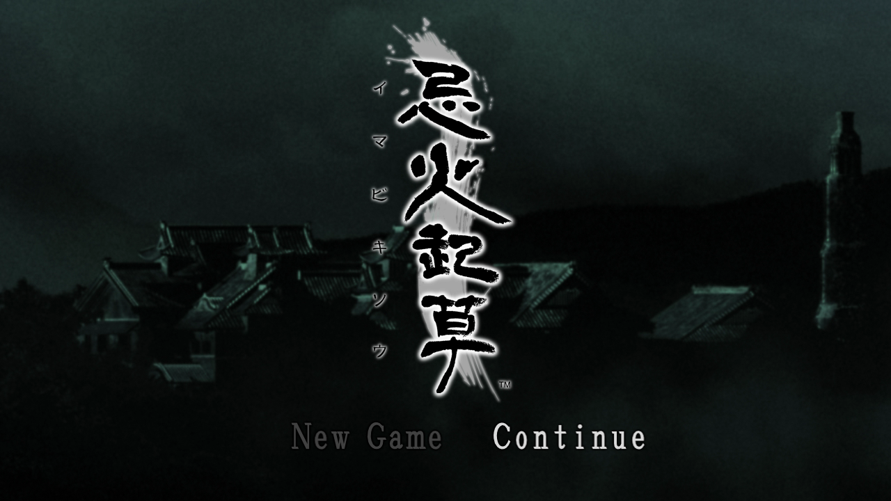
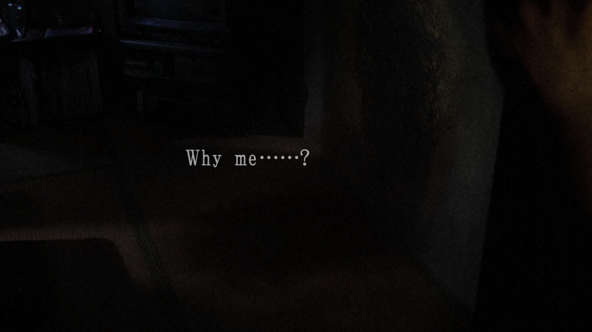
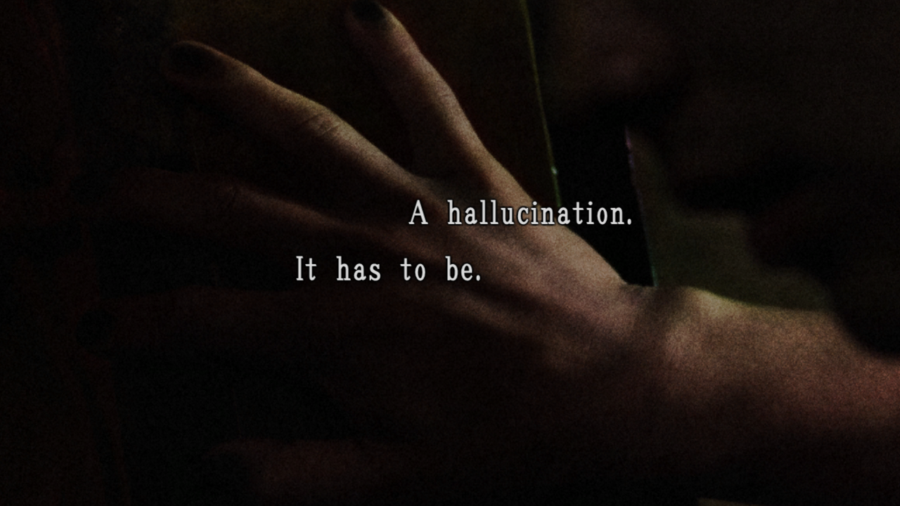
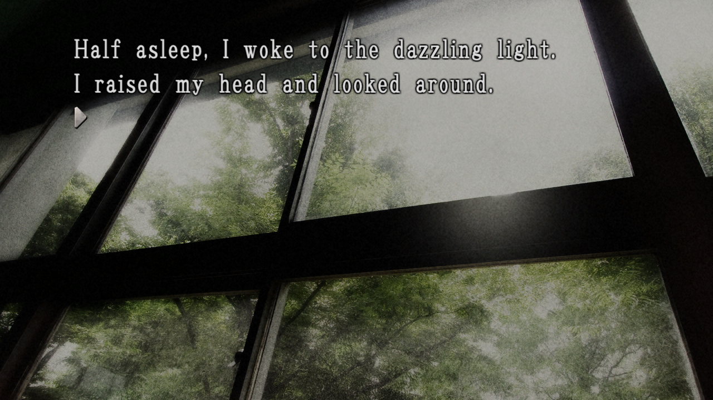

# English preview screenshots

Four lossless **1280 × 720 PNG** captures from the local native PC prototype, captured on **14 October 2026**. They show the small machine-translated English draft, not a completed localization. No image generation, retouching, color adjustment or upscaling was applied; captured frames were converted to PNG.

## 1. English title menu

Suggested caption: **Imabikisō running in the native PC prototype, with New Game and Continue translated into English. The original Japanese title logo remains unchanged.**

## 2. Opening prologue

Suggested caption: **Opening prologue displaying the English machine-translation draft: “Why me……?”**

## 3. Prologue narration

Suggested caption: **English draft narration rendered over the opening scene: “A hallucination. It has to be.”**

## 4. First classroom narration

Suggested caption: **The first classroom scene now renders its background and opening English narration in the native PC prototype.**

## Using the images in a progress post

Upload the original PNG files directly for a four-image gallery, in the numbered order above. The first two images contain the title screen and opening; the final image demonstrates the first school narration. These are early-story screenshots.

Keep the scope clear: the preview currently covers 33 script entries and 27 menu/dialog labels; the rest of the game has not been validated. Static screenshots do not demonstrate smooth movie playback or correct sound. Audio crackling and movie stutters remain.

The underlying game artwork and logo belong to their respective rights holders. Screenshots are documentation of the prototype, not MIT-licensed game assets. Preparing this gallery does not publish a Reddit post.
